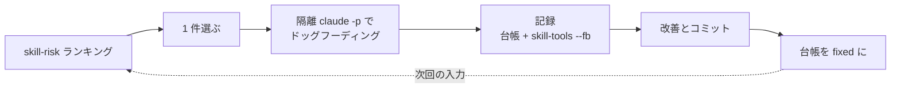

# スキルの危うさランキングとドッグフーディング周回

リポジトリ全体の `SKILL.md`（130 件前後）のうち、いま一番壊れている・古い可能性が高いものを根拠付きで選び、実際に使って確かめ（ドッグフーディング）、直す。1 回の周回で直すのは 1 スキル。手順は [skill-dogfooding](../plugin/skills/skill-dogfooding/SKILL.md) スキル、ランキングは `just --justfile maintenance/scripts/justfile skill-risk`（[rank_skill_risk.py](../scripts/skill/query/rank_skill_risk.py)）。



## 対象

4 ルート（`skills/plugins/`・`tools/_plugin/`・`agent-compat/_plugin/`・`maintenance/plugin/`）の `SKILL.md` から、祖先にも `SKILL.md` がある入れ子（`special` の `sub_skills/` など）と `meta.status: deprecated` を除いたもの。`.claude/skills/`（sync-skills のコピー）・`temp/`・`templates/.claude/skills/` は同じスキルを二重に数えるので含めない。スキルのキーは skill-tools と同じ canonical ID（リポジトリ相対の `.../SKILL.md` パス）。

## 危うさの要因

点数 1 個ではなく、要因ごとの内訳と並べて出す（`--json` で全部見える）。選んだ理由を確かめられないとランキングを信用できないため。

| 要因                     | 取り方                                                                                                                                                       | 手で書くか |
| ------------------------ | ------------------------------------------------------------------------------------------------------------------------------------------------------------ | ---------- |
| 最後の変更               | スキルのディレクトリ配下を触った最新の実質コミット（git）。一括書き換え（件名 `refactor(repo)`・`chore(repo): import`、または 100 ファイル超）は数えない     | しない     |
| 変更頻度                 | 直近 30 日の実質コミット数                                                                                                                                   | しない     |
| 最後のドッグフーディング | 台帳 `maintenance/skill-risk/dogfood.yaml` の日付と判定                                                                                                      | 周回で書く |
| 変化しやすさ             | `maintenance/skill-risk/volatility.yaml` の規則（個別の上書き → 最長 prefix → 既定）。外部ツールの仕様が題材なら high、自作ツール・リポジトリ構成なら medium | 規則だけ   |
| 依存先の変化             | `meta.requires_repo_tools`・`requires_skills` の先が、スキルの最後の変更より後に変わったか                                                                   | しない     |
| 未対応 fb                | 最後のドッグフーディングより新しい `skill-tools --fb` ファイルの数                                                                                           | しない     |

アンブレラもサブモジュールも履歴は 2026-11-10 の取り込みから始まる。それ以降に実質的な変更がないスキルは「基準日（2026-11-10 以前）」として基準日から数える。git の日付が取れないスキルは「不明」として上位に出す（確かめられないものは危うい扱い）。

### 合成点

```text
変化しやすさの重み（high 3 / medium 2 / low 1）× 最後の変更と最後のドッグフーディングの新しい方からの日数
+ 変更頻度 + 変わった依存先 + 未ドッグフーディング / 台帳の needs-fix + 未対応 fb（+ 不明）
```

重みの値はスクリプト先頭の定数が正本。ドッグフーディングした直後のスキルは日数が 0 に戻るので上位から消え、`needs-fix` のまま直さなかったものは加点で上位に残る。

利用頻度（`agent-logs` の Skill 呼び出し回数）は入れていない。Skill ツールを通らない使われ方（`Read` で直接読む、他スキルから参照される）が多く、回数が利用頻度の代わりにならないため。

## 手で書く入力（`maintenance/skill-risk/`）

- `volatility.yaml` — 変化しやすさの規則。新しいプラグインを足して「規則なし（no rule）」と出たら、ここに prefix を足す。`SKILL.md` の `meta:` に足さないのは、足すと全スキルの `meta.version` を上げることになるため。
- `dogfood.yaml` — スキルごとの最新のドッグフーディング 1 件（日付・判定 `ok`/`needs-fix`/`fixed`・`fb` ファイル名・`note`・改善コミット `fix: <repo>@<short-hash>`）。履歴は git にある。手で編集せず、[record_dogfood.py](../plugin/skills/skill-dogfooding/scripts/record_dogfood.py) で書く。

`registry/` に置かないのは、読むのがランキングのスクリプト 1 本だけで、複数の生成物・検査が読む SSOT（[repo-ssot-pattern](./repo-ssot-pattern.md)）に当たらないため。

ドッグフーディングの記録は 2 か所に分ける。本文（何が起きたか）は `skill-tools --fb`（[tool-companion-skills](./tool-companion-skills.md)）、日付と判定は台帳。`--fb` の保存先は gitignore されていて端末をまたげないので、ランキングの入力にはコミットする台帳を使う。そのため「未対応 fb」の列だけは端末によって変わりうる。`--fb` はカタログ（`ai-tools.yaml`）に登録されたスキルしか受け付けないので、`maintenance/plugin/` のスキルは `fb` 列が `n/a` になり、本文の要点を台帳の `note` に書く。

## ドッグフーディングの方法

隔離した `claude -p` に対象プラグインだけを `--plugin-dir` で読み込ませ、スキル名を出さない現実的な依頼を渡す。stream-json の `Skill` の `tool_use` で、description による自動起動まで確かめられる。Agent ツールのサブエージェントは親セッションと同じスキル集合しか持たないので、この確認には使えない。

[run_dogfood.py](../plugin/skills/skill-dogfooding/scripts/run_dogfood.py) が次の形で起動し、生の stream-json を作業ディレクトリに保存して要約だけを返す。

- `--setting-sources ""`・`--strict-mcp-config` — ユーザー・プロジェクトの設定、フック、他のプラグイン、アカウントの MCP を切り離す
- `--permission-mode dontAsk` と許可リスト — 許可リスト外のツールは確認なしに拒否される。既定は読み取り系だけで、スキルが実行するコマンドはシナリオごとに足す
- `--disallowedTools` — push・PR・Issue・`gh api`・クラウド CLI などの外部への書き込みを、広い許可を足しても常に拒否する
- 作業ディレクトリは scratch。`--no-session-persistence`

スキルの動的コンテキスト（`` !`...` ``）も許可の対象になる。許可を渡し忘れると、スキルは起動しても中身が空のまま進むので、要約の「tool errors」で気づける。

## 他のメタスキルとの棲み分け

| 仕組み                                                                           | 見るもの                                                            | 起点                         |
| -------------------------------------------------------------------------------- | ------------------------------------------------------------------- | ---------------------------- |
| skill-dogfooding（本書）                                                         | 実際に使って壊れていないか。全スキルが対象                          | 危うさランキング             |
| [skill-maintenance](../plugin/skills/skill-maintenance/SKILL.md)                 | Claude CLI・Claude Code 公式ドキュメントの差分。`cc-knowledge` だけ | 上流のスナップショットの差分 |
| `audit-skills`（Workflow）                                                       | ベストプラクティスに沿った書き方か。多数を一括で採点（費用大）      | 対象パスの指定               |
| [writing-skill](../../skills/plugins/cc-knowledge/skills/writing-skill/SKILL.md) | 書き方の基準そのもの。改善時の正本                                  | —                            |

ドッグフーディングで「上流の仕様が変わっていた」と分かった `cc-knowledge` のスキルは、`skill-maintenance` で差分を取ってから直してもよい。

## 関連

- [skill-tool-relations](./skill-tool-relations.md) — 依存先の変化の元になる辺（`requires_repo_tools`・`requires_skills`）
- [skill-md-commits](./skill-md-commits.md) — 改善したスキルをコミットするときの `meta.version` バンプ
- [skill-improving-meta-skills](./skill-improving-meta-skills.md) — メタスキル層の全体
